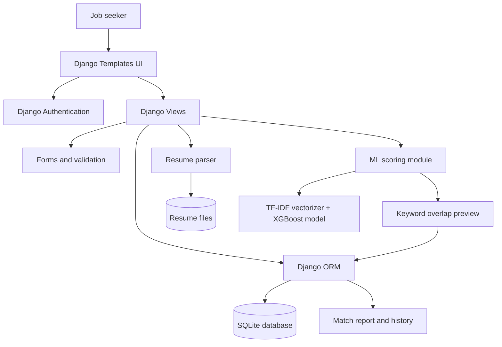

# ResumeForge architecture and workflow

## Analysis request sequence

1. An authenticated user chooses one of their own resumes and one of their own saved job descriptions.
2. Django validates ownership and retrieves extracted resume text and job-description text.
3. `analysis_app.services.analyze_resume()` calls the supplied `ml_engine.scoring.score_pair()` function.
4. The model computes the eight features used during training and returns a probability and label.
5. A separate keyword preview compares terms in the two texts. It is clearly identified as a transparent preview, not the trained model's output.
6. Django stores the score, label, feature values and keyword lists in `Analysis`.
7. The result view displays the report and history view retrieves the user's previous analyses.

## Data ownership

Every user-owned record is filtered by `request.user`. Resume downloads also verify ownership before returning a file. Resume deletion cascades to related analyses.
